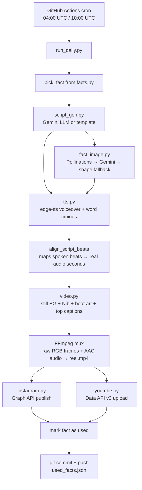

# 🥬 Nib — AI Reel Bot

A fully automated content pipeline that writes, voices, animates, and publishes short-form
vertical videos (Instagram Reels + YouTube Shorts) starring **Nib**, a cartoon mascot who
**dictates curiosity facts** — twice a day, every day, with zero manual work.

Live account: [@nibthefridgegoblin](https://instagram.com/nibthefridgegoblin)

> Give it a fact pool and a character sheet, and it will keep generating unique,
> voiced, captioned, edited 9:16 videos and auto-posting them on a schedule — forever —
> running entirely on GitHub Actions' free tier.

---

## Table of contents

- [What it does](#what-it-does)
- [Tech stack](#tech-stack)
- [Architecture overview](#architecture-overview)
- [End-to-end pipeline flow](#end-to-end-pipeline-flow)
- [Repository structure](#repository-structure)
- [How each piece works](#how-each-piece-works)
- [Getting started](#getting-started)
- [Configuration](#configuration-envexample)
- [Running the bot](#running-the-bot)
- [Daily automation (GitHub Actions)](#daily-automation-github-actions)
- [Publishing integrations](#publishing-integrations)
- [Content & anti-repetition system](#content--anti-repetition-system)
- [Character asset pipeline](#character-asset-pipeline)
- [Design decisions & gotchas](#design-decisions--gotchas)
- [License](#license)

---

## What it does

The bot posts **three times a day**: two curiosity-fact reels and one classic Nib-at-the-fridge food fact in between.

| Slot | Schedule (JST) | Cron (UTC) | Content |
|------|-----------------|------------|---------|
| **afternoon** | 1:00 PM | `7 4 * * *` | Unused fact from `facts.py` (still color BG) |
| **late afternoon** | 4:00 PM | `11 7 * * *` | Fridge goblin food fact from `topics.py` (open fridge + held food) |
| **evening** | 7:00 PM | `9 10 * * *` | Another unused curiosity fact |

Every run, fully unattended, does all of the following:

1. **Picks** an unused curiosity fact from a content bank (animals, food, psychology / dark triad, body, nature, weird science) — cycles once exhausted
2. **Writes a script** in Nib's voice (Gemini LLM if configured, deterministic template as a free fallback)
3. **Generates cartoon beat images** (Pollinations.ai free image API → Gemini image → geometric fallback)
4. **Synthesizes voiceover audio** with word-level timing via Microsoft Edge's free neural TTS
5. **Renders a 1080×1920 (9:16) video** frame-by-frame with Pillow: still backdrop, centered Nib, per-beat illustration, large top captions synced to speech, then muxes audio+video with FFmpeg
6. **Publishes** the finished MP4 to Instagram Reels (Graph API) **and** YouTube Shorts (Data API v3) — skipping any platform that isn't configured, without failing the run
7. **Commits** the "already used" fact ledger back to the repo so the next run doesn't repeat itself

---

## Tech stack

| Layer | Technology | Purpose |
|---|---|---|
| **Language / runtime** | Python 3.12 | Entire pipeline |
| **Script writing (LLM)** | Google Gemini API (`gemini-2.0-flash` family, JSON mode) | Generates punchy, on-character voiceover scripts; falls back to hand-written templates if no API key |
| **Text-to-speech** | [`edge-tts`](https://github.com/rany2/edge-tts) (Microsoft Edge neural voices, free, no API key) | Voiceover audio + word/sentence boundary timestamps for perfect caption/animation sync |
| **AI image generation** | [Pollinations.ai](https://pollinations.ai) (Flux model, free, no key) → Gemini image models (`gemini-2.5-flash-image`, optional) | Cartoon illustrations for each fact beat |
| **Image compositing / rendering** | [Pillow (PIL)](https://python-pillow.org/) + [NumPy](https://numpy.org/) | Character cutout/masking, color correction, speech bubbles, checklists, recipe cards, Ken Burns pans, frame compositing |
| **Video/audio encoding** | [FFmpeg](https://ffmpeg.org/) via [`imageio-ffmpeg`](https://github.com/imageio/imageio-ffmpeg) | Streams raw RGB frames + the TTS track into a single H.264/AAC MP4 (piped, not written frame-by-frame to disk) |
| **HTTP client** | [`httpx`](https://www.python-httpx.org/) | All REST calls: Gemini, Pollinations, Instagram Graph API, file-hosting fallbacks |
| **Instagram publishing** | Meta **Graph API** (`graph.facebook.com` / `graph.instagram.com`) v21.0 — resumable `rupload` for Page tokens, public `video_url` container flow for Instagram-Login tokens | Auto-posts the Reel with a full caption |
| **YouTube publishing** | **YouTube Data API v3** via `google-api-python-client` + `google-auth-oauthlib` (OAuth2 installed-app flow, refresh-token based) | Auto-uploads the same MP4 as a YouTube Short (`#Shorts` tag routes it to the Shorts shelf) |
| **Config / secrets** | `python-dotenv` (local `.env`) + **GitHub Actions Secrets** (production) | Keeps API keys and tokens out of source control |
| **Scheduling / CI/CD** | **GitHub Actions** (`schedule` cron triggers + `workflow_dispatch`) | Runs the whole pipeline twice a day on GitHub's hosted runners — no server, no always-on Mac required |
| **State persistence** | Flat JSON file (`bot/data/used_facts.json`) committed back to git by the workflow | Prevents repeating the same fact until the whole pool cycles |
| **Fonts** | Bundled `Roboto-Bold.ttf` with system-font fallback chain | Guarantees consistent on-video text rendering in CI (headless Linux runners have no fonts otherwise) |

No database, no backend server, and no paid infrastructure are required — the entire system is a Python CLI plus one GitHub Actions workflow.

---

## Architecture overview



---

## End-to-end pipeline flow

This is what happens inside `run_daily()` (`bot/src/pipeline.py`) for a single run:

### 1. Pose bootstrap
On first run (or if fewer than 5 pose PNGs exist), `poses.py` auto-extracts individual
character poses from the raw multi-pose character sheets in `bot/assets/nib/raw/` using
connected-component analysis (`cutout.py`), so the render step always has art to work with.

### 2. Script generation (`script_gen.py`)
- An unused fact is randomly chosen from `facts.py`, preferring a **different category** than the
  last posted fact. IDs already in `bot/data/used_facts.json` are skipped. Once the whole pool has
  been used, the ledger resets and the cycle starts over.
- If `GEMINI_API_KEY` is set, the bot asks Gemini (tries 5 model fallbacks) for a JSON-structured
  script: 4–5 beats of spoken line + short on-screen caption + cartoon `image_prompt`, ~45–70 words,
  starting with "Do you know".
- If Gemini is unavailable/unset/fails, a deterministic template uses the hand-written seed copy —
  the pipeline **never** hard-fails on a missing API key.
- The Instagram **caption** is a title + recap + hashtags, generated separately from the voiceover.

### 3. Beat image generation (`fact_image.py`)
A 3-tier fallback chain produces one square cartoon illustration per beat (Nib is **not** in the
prompt — he is composited from pose sheets):
1. **Pollinations.ai** (free, no key, Flux model) — tried first
2. **Gemini image models** (`gemini-2.5-flash-image` etc.) — only if a `GEMINI_API_KEY` exists and Pollinations fails
3. **Geometric sticker** — guarantees the pipeline *always* produces an image even fully offline

### 4. Voiceover synthesis (`tts.py`)
- `edge-tts` streams the script text through a free Microsoft neural voice (default
  `en-US-AnaNeural`, configurable rate/pitch) and captures **WordBoundary**/**SentenceBoundary**
  events as it synthesizes — giving millisecond-accurate timestamps for every spoken word, not just
  an estimated guess.
- `align_script_beats()` then maps each spoken beat onto the real timestamp where those words are
  actually spoken, so on-screen captions stay in sync with the audio.

### 5. Video rendering (`video.py`)
The renderer uses a **manual FFmpeg pipe**, not a video-editing library.
- For every frame (30 FPS, up to 45s), the code:
  - Fills a **still** muted-indigo background (no Ken Burns, no fridge/kitchen photos)
  - Selects the correct character pose for the current speech beat
  - Composites Nib (cutout from character sheets, soft shadow, bounce/sway, horn-color correction) centered near the bottom
  - Pops in the beat's cartoon illustration above Nib
  - Draws large white top captions (2–6 words) from the beat `caption`, not the full spoken line
  - Encodes raw RGB frame bytes into an FFmpeg subprocess (`stdin`), muxing the AAC voice track
- Output: `reel.mp4` — H.264 video (yuv420p, level 4.0) + AAC 48kHz stereo audio, `+faststart`

### 6. Publishing
- **Instagram** (`instagram.py`): detects whether the configured token is a Facebook **Page** token
  (`EAA…`, uploads the file directly via Meta's resumable `rupload` endpoint — most reliable) or an
  **Instagram Login** token (`IGAA…`, which requires a public HTTPS `video_url`; the bot auto-hosts
  the MP4 on pixeldrain/litterbox as a fallback, verifying the URL is byte-fetchable before handing
  it to Meta). It then polls the media container until Meta finishes processing before publishing.
- **YouTube** (`youtube.py`): refreshes an OAuth2 access token from a long-lived refresh token, then
  resumable-uploads the same MP4 via `videos.insert`, appending `#Shorts` to the title/description
  (which is what routes a ≤60s 9:16 upload into the Shorts shelf).
- If either platform's credentials are missing, that platform is **skipped silently** — the other
  still posts, and the run is not marked as failed.

### 7. State persistence
The used fact ID is appended to `bot/data/used_facts.json`. The GitHub Actions workflow then commits
and pushes that ledger back to the repository so the next scheduled run (potentially on a fresh
runner) knows what has already been posted.

---

## Repository structure

```text
AI Reel bot/
├── .github/workflows/
│   ├── daily-fact-reel.yml      # Cron: fact reels @ 1PM and 7PM JST
│   └── daily-fridge-reel.yml    # Cron: fridge food-fact @ 4PM JST
├── bot/
│   ├── run_daily.py           # CLI entrypoint (argparse)
│   ├── get_youtube_refresh_token.py  # One-time OAuth helper for YouTube
│   ├── requirements.txt
│   ├── .env.example           # Template for local secrets
│   ├── INSTAGRAM_TOKEN_GUIDE.md      # Deep-dive token setup/renewal walkthrough
│   ├── README.md              # Bot-specific quick-start docs
│   ├── assets/
│   │   ├── bg/                 # unused scene photos (fact reels use a still color)
│   │   ├── fonts/               # Bundled Roboto-Bold.ttf (for headless CI)
│   │   └── nib/
│   │       ├── raw/            # Original multi-pose character sheets
│   │       └── poses/          # Auto-cropped individual pose PNGs (generated)
│   ├── data/
│   │   └── used_facts.json      # "already posted" fact ledger
│   ├── output/                  # Generated reels land here: <timestamp>/reel.mp4
│   └── src/
│       ├── config.py            # Env loading, paths, palette, video constants
│       ├── facts.py             # Curiosity-fact content bank
│       ├── script_gen.py        # LLM + template script writer, caption formatting
│       ├── fact_image.py        # Per-beat cartoon image generation (3-tier fallback)
│       ├── tts.py               # edge-tts voiceover + word-timing alignment
│       ├── video.py             # Still-BG fact renderer + FFmpeg pipe
│       ├── poses.py             # Character sheet → individual pose extraction
│       ├── cutout.py            # Background removal (flood-fill from edges)
│       ├── horns.py             # Color-correction for mis-tinted character art
│       ├── fonts.py             # Cross-platform bold font loader with fallbacks
│       ├── instagram.py         # Graph API Reels publishing (2 upload strategies)
│       ├── youtube.py           # YouTube Data API v3 Shorts upload
│       └── pipeline.py          # Orchestrates the whole run_daily() flow
```

---

## How each piece works

<details>
<summary><strong>Content bank (<code>facts.py</code>)</strong></summary>

Plain Python list of dicts — no database. Each **fact** has an id, category, title, and 4–5 beats
(`spoken`, `caption`, `image_prompt`). Categories rotate so consecutive posts are less likely to
repeat the same bucket. Adding new content is as simple as appending a new dict.
</details>

<details>
<summary><strong>Character rendering pipeline</strong></summary>

The mascot "Nib" is drawn once as multi-pose reference sheets (`assets/nib/raw/`). At runtime:
1. `poses.py` slices out each individual pose using bounding-box detection over the sheet's
   non-white pixels (flood-fill connected components).
2. `cutout.py` removes the sheet's background color via border-color sampling + flood-fill (only
   removing background connected to the image edges, so white eye highlights inside the character
   are preserved).
3. `horns.py` recolors any inconsistently-tinted horn pixels back to Nib's canonical slate-blue,
   preserving shading via a luminance remap — a fix for slightly-off source art.
4. The cleaned, cropped PNGs are cached to `assets/nib/poses/*.png` so this only runs once.
</details>

<details>
<summary><strong>Speech/beat synchronization</strong></summary>

`tts.py`'s `align_script_beats()` takes each beat's spoken line and greedily locates those words
inside the real Edge-TTS word-timing stream
(exact match → fuzzy 3-word match → first-word match, in that priority order), so even if the LLM's
returned text doesn't 100% match what TTS "hears," captions stay reasonably in sync. Beat end-times
are stretched forward to the next beat's start for continuous coverage with no dead gaps.
</details>

<details>
<summary><strong>Video compositing without a video-editing library</strong></summary>

Rather than using MoviePy or similar, the renderer builds each animation frame as a plain Pillow
`Image`, writes its raw RGB bytes straight to an FFmpeg subprocess's stdin
(`-f rawvideo -pix_fmt rgb24`), and lets FFmpeg do the actual H.264 encoding + audio muxing in real
time. This keeps memory bounded (no giant frame-array buffers) and avoids ever touching the disk
for intermediate frames.
</details>

---

## Getting started

### Prerequisites
- Python 3.12+
- FFmpeg is **not** required as a system package — `imageio-ffmpeg` bundles a static binary automatically
- (Optional) A [Google Gemini API key](https://aistudio.google.com/apikey) — free tier is enough
- (Optional) An Instagram **Professional** account linked to a Facebook Page, for auto-posting
- (Optional) A Google Cloud project with the YouTube Data API v3 enabled, for auto-posting

### Install

```bash
cd "AI Reel bot"
python3 -m venv .venv
source .venv/bin/activate
pip install -r bot/requirements.txt
cp bot/.env.example bot/.env
```

### One-time: extract character poses

```bash
.venv/bin/python bot/run_daily.py --extract-poses
```

---

## Configuration (`.env.example`)

Copy `bot/.env.example` to `bot/.env` and fill in whichever integrations you want. Every value is
optional — the bot degrades gracefully (template scripts, free image gen, and skipped publishing)
when keys are missing:

| Variable | Required for | Notes |
|---|---|---|
| `GEMINI_API_KEY` | Smarter LLM-written scripts + Gemini image fallback | Get one free at [aistudio.google.com/apikey](https://aistudio.google.com/apikey) |
| `INSTAGRAM_USER_ID` / `INSTAGRAM_ACCESS_TOKEN` | Auto-posting to Instagram | See [Publishing integrations](#publishing-integrations) |
| `YOUTUBE_CLIENT_ID` / `YOUTUBE_CLIENT_SECRET` / `YOUTUBE_REFRESH_TOKEN` | Auto-posting to YouTube Shorts | Generated once via `bot/get_youtube_refresh_token.py` |
| `YOUTUBE_PRIVACY_STATUS` | — | `public` / `unlisted` / `private` (default `public`) |
| `EDGE_TTS_VOICE` / `EDGE_TTS_RATE` / `EDGE_TTS_PITCH` | — | Defaults to a cute/cartoon-sounding neural voice (`en-US-AnaNeural`, `+20%` rate) |
| `AUTO_POST` | — | `true`/`false` — whether `run_daily()` publishes by default without `--post` |

---

## Running the bot

Generate a reel without posting:

```bash
.venv/bin/python bot/run_daily.py                # fact reel (default)
.venv/bin/python bot/run_daily.py --type fact
```

`--type fridge` and `--type meal` still work; they map to the same fact format.

Output lands in `bot/output/<timestamp>/` as `reel.mp4` + `caption.txt` + `beat_*.png`.

Generate **and** publish immediately:

```bash
.venv/bin/python bot/run_daily.py --type fact --post
```

Retry publishing an already-rendered video:

```bash
.venv/bin/python bot/run_daily.py --post-file bot/output/<timestamp>/reel.mp4
```

---

## Daily automation (GitHub Actions)

Two scheduled workflows post three times a day without any machine staying online:

| Workflow | Cron (UTC) | Local (JST) | Command run |
|---|---|---|---|
| [`daily-fact-reel.yml`](.github/workflows/daily-fact-reel.yml) | `7 4 * * *` | 1:00 PM | `python bot/run_daily.py --type fact --post` |
| [`daily-fridge-reel.yml`](.github/workflows/daily-fridge-reel.yml) | `11 7 * * *` | 4:00 PM | `python bot/run_daily.py --type fridge --post` |
| [`daily-fact-reel.yml`](.github/workflows/daily-fact-reel.yml) | `9 10 * * *` | 7:00 PM | `python bot/run_daily.py --type fact --post` |

The fact workflow commits `used_facts.json`; the fridge workflow commits `used_topics.json`.
Both can be triggered manually via `workflow_dispatch`
(*Actions → Daily Nib Fact Reel* or *Daily Nib Fridge Reel*, or
`gh workflow run daily-fact-reel.yml` / `gh workflow run daily-fridge-reel.yml`).

**Required repo secrets** (Settings → Secrets and variables → Actions):
`INSTAGRAM_USER_ID`, `INSTAGRAM_ACCESS_TOKEN`, `YOUTUBE_CLIENT_ID`, `YOUTUBE_CLIENT_SECRET`,
`YOUTUBE_REFRESH_TOKEN`, `GEMINI_API_KEY`.

---

## Publishing integrations

### Instagram Graph API
Requires a **Professional** Instagram account linked to a Facebook Page. The bot supports two
token types transparently (auto-detected by prefix):
- **Facebook Page token (`EAA…`, recommended)** — uploads the local MP4 file directly via Meta's
  resumable `rupload` endpoint. Most reliable for locally/CI-rendered files.
- **Instagram Login token (`IGAA…`)** — Meta requires a public `video_url` for this token type, so
  the bot temporarily hosts the file on pixeldrain (falling back to litterbox) and verifies the URL
  serves real video bytes before handing it to the Graph API.

Full step-by-step token generation/renewal instructions (including every edge case encountered
while building this) live in [`bot/INSTAGRAM_TOKEN_GUIDE.md`](bot/INSTAGRAM_TOKEN_GUIDE.md).

### YouTube Data API v3
Uses an OAuth2 "installed app" client + a one-time-generated **refresh token** (no browser
interaction needed on subsequent runs/CI). Run `bot/get_youtube_refresh_token.py` once locally to
mint the refresh token, then store it as a secret. The same rendered MP4 is uploaded as a Short by
appending `#Shorts` to the title/description — there's no separate "Shorts" upload endpoint; a
≤60s, 9:16 video with that tag is automatically routed to the Shorts shelf.

---

## Content & anti-repetition system

`bot/data/used_facts.json` is a simple JSON array of fact IDs
that have already been posted. Each run:
1. Filters the content bank down to unused IDs (and prefers a new category vs the last post)
2. Randomly picks one
3. Marks it used and appends it to the ledger (trimmed to the last 200 entries)
4. If the entire pool has been exhausted, the ledger resets and the cycle restarts

Because these files are committed back to the repo by the GitHub Actions workflow, the rotation
survives across ephemeral CI runners indefinitely.

---

## Character asset pipeline

The `Nib` mascot only needs to be drawn once, as a handful of multi-pose reference sheets:

```text
bot/assets/nib/raw/
├── Nib_master.png        # idle pose + fridge-holding pose
├── Nib_expression.png    # front/side/three-quarter + happy/shocked/judging/celebrating
├── nib_talk.png          # 7 talking poses (wave, chew, bite, thumbs up, laugh, content, cheer)
└── nib_judge.png         # 7 judging poses (bored, shrug, think, approve, serious, sincere, excited)
```

Running `bot/run_daily.py --extract-poses` (or simply letting the pipeline auto-trigger it the
first time `list_poses()` finds fewer than 5 cached poses) slices these sheets into ~20 individual
transparent PNGs in `bot/assets/nib/poses/`, ready for the renderer to composite per speech "beat."

---

## Design decisions & gotchas

- **Every paid API is optional.** Gemini (scripts + images) and both social platforms degrade to
  free/local fallbacks or are silently skipped — the bot can run start-to-finish on zero API keys
  and zero dollars, producing a local MP4 you can post manually.
- **Real audio timing drives the video, not the other way around.** Beat/caption sync is derived
  from actual TTS word-boundary events, not fixed estimated durations.
- **Frames are piped, never written to disk.** The renderer streams raw RGB bytes directly into
  FFmpeg's stdin, keeping memory bounded and avoiding thousands of temp PNG files per render.
  Audio is encoded to AAC @ 48kHz because Instagram/YouTube reject some of edge-tts's native 24kHz
  output otherwise.
- **Nib is never AI-generated.** Beat images are cartoon props/scenes only; the mascot is always
  composited from the pose sheets so he stays on-model.
- **Still background.** Fact reels use a flat color — no Ken Burns scene photos.
- **CI-safe fonts.** A bundled `Roboto-Bold.ttf` avoids relying on system fonts that don't exist on
  headless Ubuntu GitHub-hosted runners.
- **Token type is auto-detected.** `instagram.py` picks the correct Graph API host and upload
  strategy purely from whether the token starts with `EAA` (Facebook Page) or `IGAA`
  (Instagram Login) — no separate config flag needed.

---

## License

No license file is currently included — treat this as "all rights reserved" by default unless the
repository owner adds one. Character art (`bot/assets/nib/`) is original artwork for
[@nibthefridgegoblin](https://instagram.com/nibthefridgegoblin) and is not licensed for reuse.
